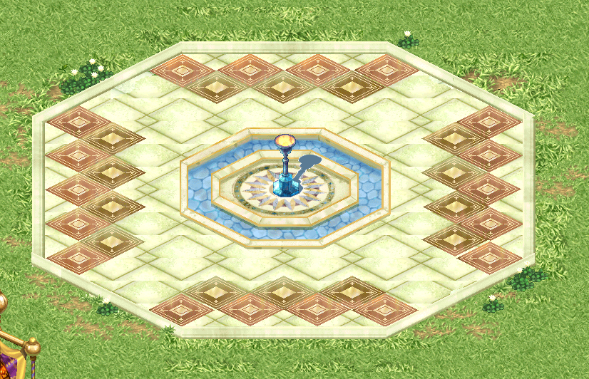
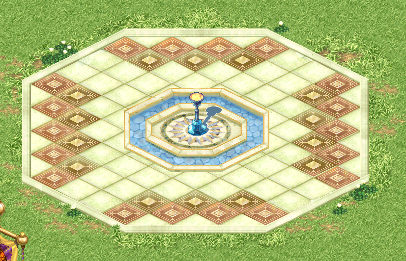

# TricksterMap 0.3.1：地磚接縫方向修正

使用者提供的 map_sq14a 遊戲與編輯器畫面顯示，廣場菱形地磚在編輯器內有鋸齒狀、錯接的邊線。原因是前版預覽把 TIL 原始紋理當成正高度 BMP，對每個 32×32 地磚預設上下翻轉；位置與索引未亂掉，但地磚內部像素反向，花紋無法連續。碰撞格線會增加視覺雜訊，但不是接縫錯誤的根因。

[下載 0.3.1](../../deliverables/map-editor/TricksterMap-editor-0.3.1-win.zip)，完整解壓後啟動同目錄 EXE。原始遊戲地圖不用重畫。若曾用舊版匯入自製圖集，請從原圖重新匯入，因為舊版編碼與預覽同時反轉，會互相抵銷而看似正確；不會猜測並自動改寫既有 TIL。

## 修正與回歸

- Core 新增 SceneTilePixelCodec：tile-major RGB555，每個地磚內由上往下儲存。只有高位旗標 bit0／bit1 設定時才水平／垂直翻轉。
- 場景繪製、調色盤縮圖與 PNG／BMP 圖集匯入共用此規則。既有索引、旗標、原始地圖配套保持不變。
- 新增 6 項回歸案例，含四種翻轉、紅綠／藍白不對稱四角、兩個圖塊的原始編碼順序、透明鍵與邊界。
- GUI 匯入驗證直接檢查 TIL 首／末像素的原始 bytes，再檢查預覽；不能只讓編碼與解碼互相翻轉後通過。

## 結果

| 檢查 | 結果 |
|---|---|
| Release 建置 | 0 警告、0 錯誤 |
| 自動測試 | 141 通過、0 失敗 |
| 最終二進位全量繪製 | 700 通過、0 失敗、3 份非 MDN／配套不全略過 |
| 原始資料無操作往返 | 700 MDN、699 LYR／TIL 配套逐位元相同 |
| 封裝 GUI | sq14a、sq00、無地磚 mapg02 三案通過，含圖集匯入與原始 bytes 方向驗證 |
| 同圖方向比對 | 封裝版預設畫面與原版僅取消地磚垂直反轉的控制組 PNG 完全相同 |
| 封裝 EFF／資源匯出 | sq00 可見效果與 ZIP 匯出通過 |
| 交付檔與 CLI | 34 檔雜湊、來源 ZIP CRC、CLI 單格副本修改通過 |

最後全量繪製的 GUI／Core SHA 與封裝二進位完全相同。原始 MD3／LYR／TIL／BAC／EFF 在方向對照測試前後雜湊一致。

[測試 TRX](automated-tests.trx)、[完整繪製](corpus-render/corpus-render.json)、[MDN 往返](mdn-roundtrip.json)、[場景往返](scene-roundtrip.json)、[交付檢查](delivery-verification.json)、[機器可讀摘要](verification-summary.json)。

## 原生證據與範圍

REA／Ghidra 靜態重新核對 TIL dispatcher `0x57cdc0`、壓縮路徑 `0x57caa0`、原始群組讀取 `0x57a780`、tile word 繪製 `0x57f670`、sprite draw `0x57a060` 與翻轉 `0x579a40`。原始組語可見 bit0／bit1 交換相應邊界；地磚索引與群組位元未因此重排。每塊預設反轉的錯誤由本地原始像素、四種變體及使用者的遊戲參考畫面共同定位。

[REA Evidence bundle](native-tile-evidence.json)保留 6 份函式證據，精確 ID 見摘要。原客戶端 SHA `4bb6843be21f5bd52d3e61e4d3a036a8cd49d2ac9f8af47401f81f7dc80dfd43`；載體 SHA `89b680c90fea876d8e5ef8e37a7dd889230db079c408c7f4baf3a0ccac134205`，5 個保留原 VA 的區段與原檔逐位元核對相同。載體不可部署，未執行。反編譯部分堆疊參數未完整還原，不把偽碼簽章當作原始碼；GPU 紋理上傳全鏈未涵蓋於這個聚焦載體。

本輪修正的是地磚像素方向，不代表整個遊戲渲染已逐像素一致。完整深度、光照、動態頂點與特效時序仍沿用 [0.3.0 限制](../map-editor-v3/REPORT.md)。未替換遊戲／伺服器檔案，也未重新啟動遊戲作新的同相機逐像素測量。

EXE SHA-256：`81d57e3fcf2bc712e19cbc472ee5b194f5567587ee640f2904bca2dd8757597e`。

ZIP SHA-256：`a901a1d2a7886d0af8f2dfa7d94d36edb6222eef52e5e129cc095900011c4d04`。
